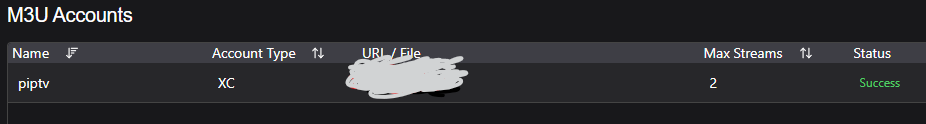
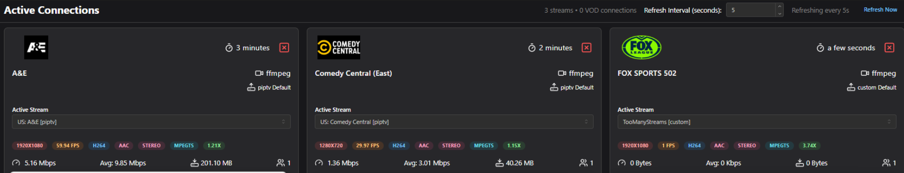
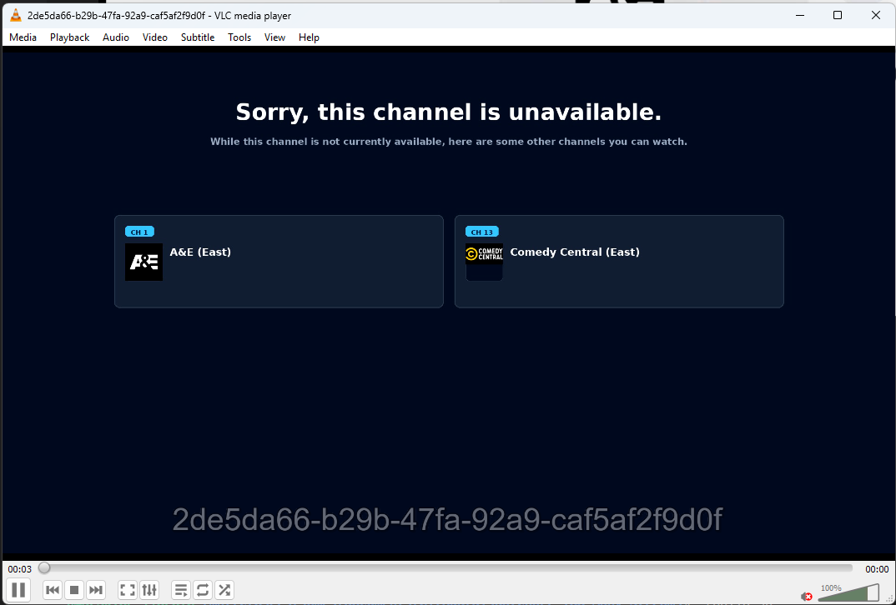

# Too Many Streams for Dispatcharr

Display a warning video when Dispatcharr cannot open another upstream channel because the configured **provider connection limit** is full.

## What the limit means

For a provider that permits one connection:

- Two viewers watching the **same channel** can share Dispatcharr's existing upstream connection.
- A second viewer requesting a **different channel** needs another provider connection. When the native allocator reports capacity exhaustion, this plugin supplies a local warning stream instead.
- An available backup provider/profile is still preferred to the warning. Dispatcharr remains responsible for selecting streams, reserving slots, respecting profile restrictions and releasing connections.

This does **not** replace Dispatcharr's separate per-user `stream_limit` check, detect credentials used directly outside Dispatcharr, or turn provider/network/authentication errors into successful playback. Keep provider limits at the purchased allowance; do not increase limits to suppress a warning.

## Compatibility update

This update targets the current **Dispatcharr v0.33.0** live-proxy interface and the four-value stream-allocation contract also used in v0.31.0. It replaces the obsolete `ts_proxy` integration and delegates normal selection/accounting to Dispatcharr instead of maintaining a second allocator. See the pull request's test report for the exact validated scope; a contract test or generated warning video is not a production deployment test.

Older releases advertised by previous versions of this README are not covered by this update. Back up your database, plugins and existing channel assignments before changing a production plugin. Do not test an upgrade during active viewing.

## Deployment boundaries and upgrade notes

This contribution is **not yet a production-readiness claim**. Exact guarded host versions are **0.31.0 and 0.33.0**; other versions are rejected until their contracts are reviewed.

- **Multiworker hosts (uwsgi/Celery/Daphne) are supported.** The first process to start owns the loopback listener; other processes attach their hooks and share its stream URL after a health check. A busy port with no healthy TooManyStreams listener still fails closed rather than hijacking an unknown service.
- Upgrading from the old plugin requires a clean application restart to remove its old monkeypatch, and removal of legacy custom `TooManyStreams` channel-stream associations **before enabling** this version. Back up and preview that migration first. Old warning URLs may use `0.0.0.0`, `localhost`, another port or a previous host, so matching only the new loopback URL is insufficient.
- The retained **Prepare automatic capacity warning** action creates metadata only. It no longer appends a warning to every channel. Native provider/account limits and channel priorities remain authoritative.
- Native HTTP 429 per-viewer rejections are intentionally unchanged. The warning is supplied at native URL resolution only after observed provider-capacity exhaustion; no fake provider profile or reserved slot is returned.
- Full Django/Redis/worker integration, multiworker behavior, native spawn/platform behavior and HLS/custom-output/hardware-encoder combinations still need host-matching validation. The real-media test injects the process/DB adapters; it verifies actual HTTP, FFmpeg encoding, decoding and shutdown, not an entire Dispatcharr server.

## Build and install

1. Use a checkout of the reviewed source, not the old prebuilt ZIP in repository history.
2. Build a real installable ZIP:

   ```sh
   python3 scripts/build_plugin.py
   # or: bash build.sh
   ```

   The output is `dist/too_many_streams.zip`, containing a top-level `too_many_streams/` directory. The build includes runtime sources, manifest, requirements and license; it excludes logs, caches, local configuration and generated images. CI also publishes the tested ZIP as an artifact.
3. Ensure the Dispatcharr runtime has the dependencies in `requirements.txt`, FFmpeg with `libx264`/AAC/lavfi/MPEG-TS support, and a writable plugin directory. Normal Dispatcharr images may already include them. Do not blindly upgrade packages in a running production container.
4. Upload the newly built ZIP through Dispatcharr's private **Plugins** page. Review the settings before enabling it.
5. Test an allowed first channel, another viewer joining that channel, and a second distinct channel when the provider is full. Confirm that the first viewer stays healthy, the rejected channel shows readable video, and closing/reopening releases slots correctly.

Use server-side proxy playback. A remote player cannot fetch a warning redirected to the server's loopback address. Do not open a public firewall port or proxy route for the internal warning listener.

## Configuration

The plugin keeps the configurable title, description, theme colors, channel-grid layout and encoder fields. Start with `libx264` (CPU), rather than assuming hardware encoders are available.

Recommended environment:

```text
TMS_HOST=127.0.0.1
TMS_PORT=1337
TMS_LOG_LEVEL=INFO
```

The internal HTTP listener and Dispatcharr's stream fetcher must share a network namespace. This matters when Docker sidecars or modular workers are used. Never publish port 1337 to the internet.

Suggested warning text:

> **Connection limit reached**
>
> All provider connections are in use. Close another channel or join one already playing, then retry.

Avoid wording that accuses a particular viewer of sharing: this warning reflects **provider capacity**, not proof of account misuse. Dynamic channel cards describe server-wide activity, not a requester-filtered list; consider that privacy boundary before using them on a server with private channel metadata. Do not include provider credentials in images, settings, screenshots or logs.

## Development and validation

Use an isolated environment without production credentials:

```sh
python3 -m venv .venv
. .venv/bin/activate
python -m pip install -r requirements.txt ruff
python -m unittest discover -s tests -v
python -m ruff check --select E9,F63,F7,F82 plugin.py src scripts tests
python scripts/build_plugin.py
```

FFmpeg and ffprobe are needed for the real loopback HTTP/video smoke test. Set `TMS_REQUIRE_MEDIA_TESTS=1` to fail rather than skip when they are missing. Tests use synthetic provider/host fixtures and a locally generated image; they must not contact IPTV providers or use real accounts.

The media smoke test fetches the warning over local HTTP and verifies H.264, AAC and a player-compatible pixel format with ffprobe, then checks cleanup. Packaging tests compare archive contents with source and check reproducibility. CI runs on Python 3.13 and 3.14 with read-only repository permissions.

## Examples





## Credits and license

- Original plugin: [JamesWRC](https://github.com/JamesWRC).
- Thanks to [CoRe-za](https://github.com/CoRe-za) for the Pillow/broadcaster overhaul; the upstream README credits Gemini-cli for that development.
- This compatibility contribution is AI-assisted. Automated checks and their limitations are documented rather than presented as a production safety certification.
- The existing [CC BY-NC-SA 4.0 license](LICENSE) is unchanged.
